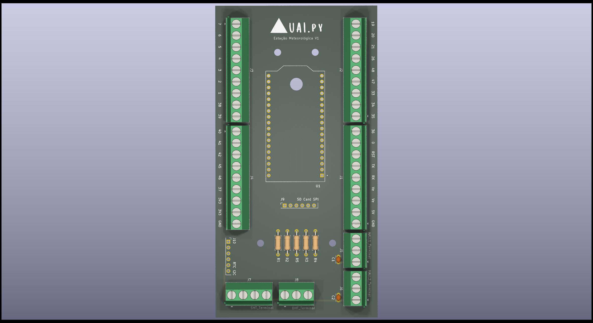

# Estação de Controle de Irrigação via LoRa

Bem-vindo ao repositório da placa de controle para um sistema de irrigação inteligente. Este projeto utiliza um microcontrolador ESP32 e comunicação sem fio de longo alcance LoRa para criar um "nó" de sensoriamento e acionamento que pode ser instalado diretamente no campo.

## 📜 Descrição

Esta PCB foi projetada para atuar como um nó remoto em um sistema de agricultura de precisão ou jardinagem automatizada. Ela não necessita de conexão com a internet (Wi-Fi), comunicando-se via rádio LoRa com uma estação base (gateway) que pode ser outro ESP32, um computador, ou uma unidade UAI.py conectada a uma porta serial. A placa serve como um hub para o módulo ESP32 (WIFI_KIT_32_V3), oferecendo conexões robustas para ler sensores de campo e acionar atuadores como válvulas ou bombas.

## ✨ Características Principais

* **Microcontrolador:** Soquete para o módulo ESP32 WIFI_KIT_32_V3.
* **Comunicação:** Conexões preparadas para um módulo de rádio LoRa, permitindo comunicação sem fio de longo alcance e baixo consumo de energia.
* **Conexões para Sensores e Atuadores:**
    * Bornes de parafuso (Screw Terminals) para conexões externas robustas com sensores (umidade do solo, nível de água, etc.) e atuadores (válvulas solenoide, relés).
    * Conectores dedicados para periféricos I2C (RTC, sensores de precisão) e SPI (cartão SD para data logging local).
* **Design Robusto para Campo:**
    * Plano de terra (Ground Plane) para maior estabilidade e imunidade a ruídos.
    * Furos de montagem para fixação em um case ou painel de controle.
    * Circuitos de desacoplamento e pull-up para garantir a integridade dos sinais dos sensores.

## 📁 Estrutura do Repositório

* **/hardware**: Contém todos os arquivos do projeto KiCad (esquemático, layout da PCB, etc.).
* **/firmware**: (Em desenvolvimento) Conterá o código-fonte para o ESP32, incluindo a lógica de controle e a comunicação via LoRa.
* **/gerber**: Arquivos Gerber e de furação prontos para enviar para uma fabricante de PCBs.
* **/docs**: Contém datasheets, logos e outros documentos de suporte.
* **/img**: Imagens e renders da placa.

## 🛠️ Fabricação

Para fabricar sua própria placa:
1.  Faça o download do arquivo `.zip` da pasta `/gerber`.
2.  Envie este arquivo para a sua fabricante de PCBs preferida (ex: JLCPCB, PCBWay, etc.).
3.  As configurações padrão (placa de 2 camadas, 1.6mm de espessura, cobre de 1oz) são suficientes.

## 📄 Licença

Este projeto é distribuído sob a licença MIT. Veja o arquivo `LICENSE` para mais detalhes.
